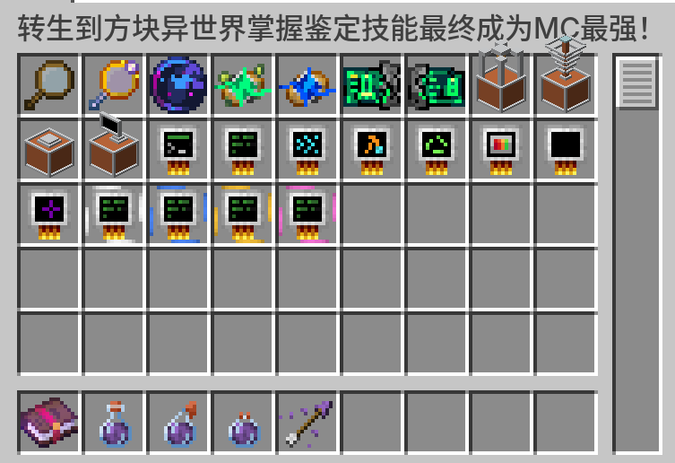
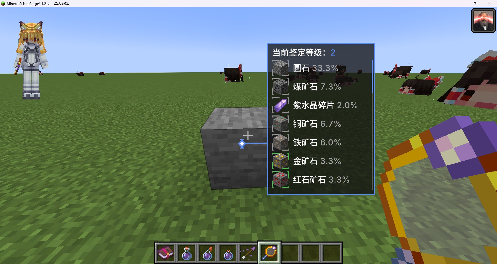
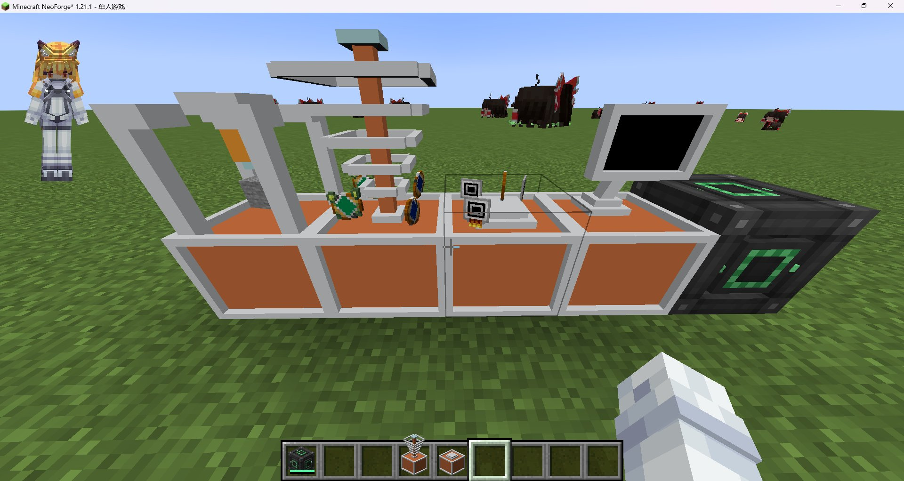
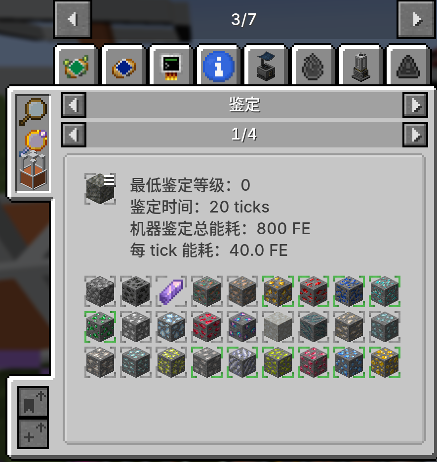
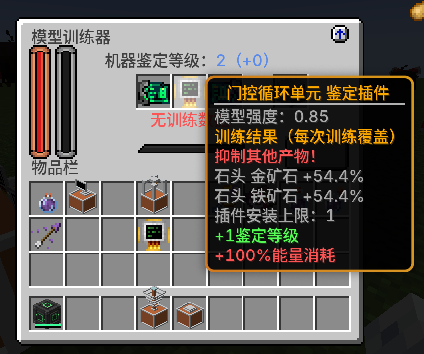

# Reincarnated into a Block World: Mastering Appraisal to Become the Strongest in MC!

**English** | [中文](README.zh_cn.md)

Appraisal is a mod built around an appraisal system that turns stone into ores. It works like an alternative take on Ex Nihilo: simpler, more convenient, and with plenty of room for expansion. It is intended for skyblock packs. The mod currently targets modern Minecraft versions and NeoForge.

The mod adds appraisal tools and automated machines. Some textures are adapted from Calamity, a well-known Terraria mod.

## Introduction

The appraisal system has two modes: direct appraisal and advanced appraisal.

Direct appraisal uses your appraisal level to decide which blocks and outputs you can reach. If your level is too low, some blocks cannot be appraised, and some of their outputs will not appear. You can raise your level with enchantments, potions, and better appraisal tools, unlocking higher-tier recipes step by step.

## Direct Appraisal

Direct appraisal is the manual path. Right-click a block with a magnifying glass, and the mod rolls one output from the recipe's weight pool. The block is consumed and the tool loses a point of durability. It is suitable for appraising on the move and for processing large amounts of stone on a skyblock island.

## Advanced Appraisal

Advanced appraisal is the automated path and requires machines. Each output is rolled independently, so a single appraisal can yield several materials at once, and a high enough probability can produce extra copies. The appraisal machine uses this mode by default, which makes it suitable for automated production lines.

With modern Minecraft versions and KubeJS, writing appraisal recipes is straightforward.

The Model Trainer can also train a classification model for specific outputs. Put a block data card and an experience data card into the trainer, and it will read the outputs recorded in the block card and train a classification model plugin with multipliers for those outputs. Install the plugin in an appraisal machine to raise their chance. Training with a Void Plugin also gives the model a trait that suppresses other outputs. Trained models are named after classification algorithms, which occasionally produces amusing results.

## Afterword

Thanks to the large language model, I made my first mod (AI slop).
