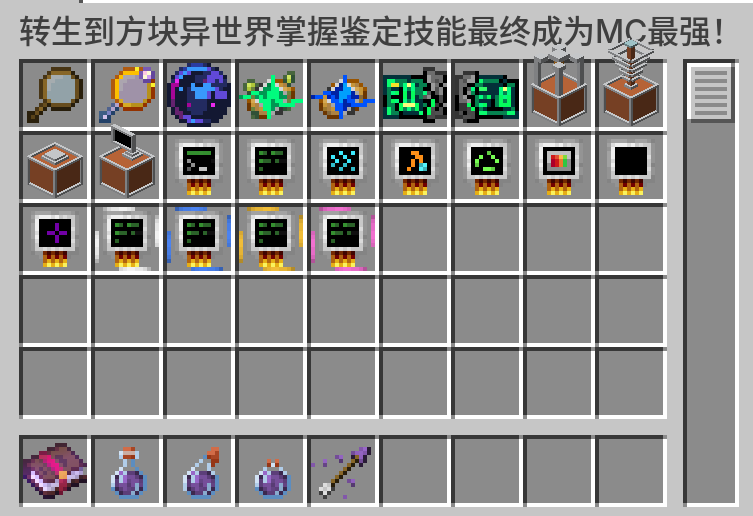
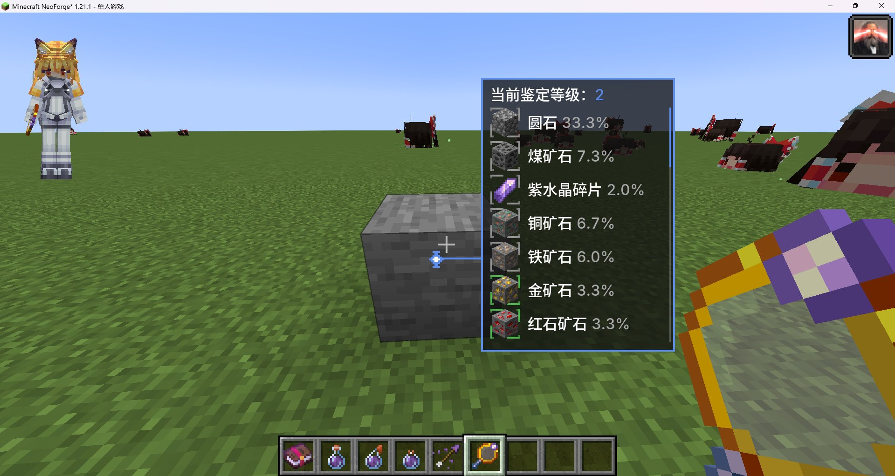
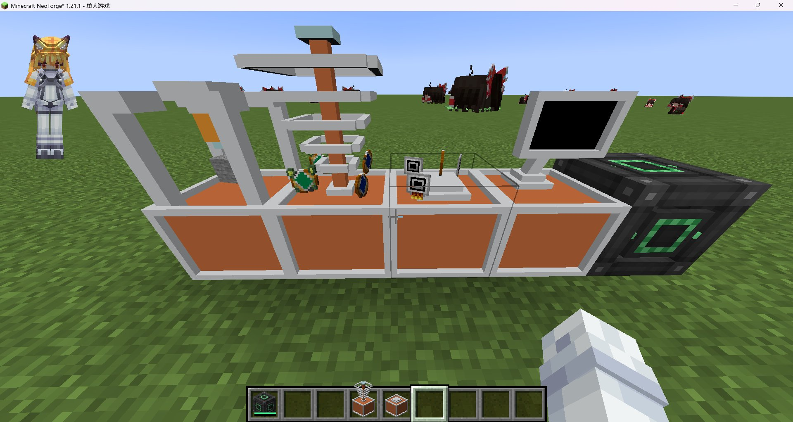
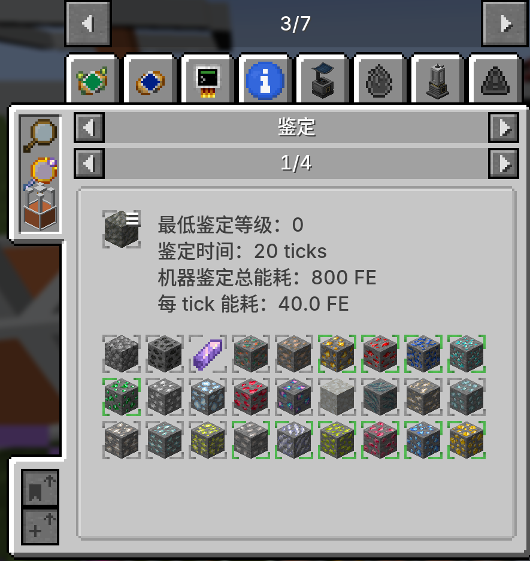
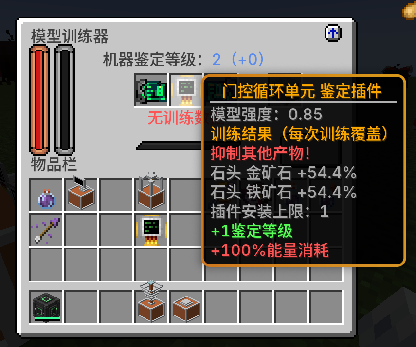

# 《转生到方块异世界掌握鉴定技能最终成为 MC 最强！》

[English](README.md) | **中文**

《转生到方块异世界掌握鉴定技能最终成为 MC 最强！》是一个允许基于鉴定系统把石头转化为矿石的模组。可以看作是另类的无中生有模组，但是更简单方便，拥有高拓展性，推荐用于空岛整合包。目前只面向高版本与 NeoForge。

模组新增了鉴定工具与相关自动化设备，部分贴图改自《泰拉瑞亚》知名模组《灾厄》。

## 简介

鉴定系统分为直接鉴定和进阶鉴定。

直接鉴定模式下，等级决定玩家能接触到的产物。等级不够时，无法鉴定一些方块，或者无法鉴定出该方块下的产物。玩家可以通过附魔、药水和更好的鉴定工具提升等级，逐步解锁更高等级的配方。

## 直接鉴定

直接鉴定是手动鉴定的方式。玩家拿着放大镜右键方块，模组会从配方的权重池里抽取一个产物。方块会被消耗，放大镜消耗一点耐久。这种方式适合在探索时随手鉴定，也适合在空岛上快速处理大量石头。

## 进阶鉴定

进阶鉴定也就是自动化鉴定，需要靠机器完成。每个产物独立判定，一次鉴定可以同时得到多种材料，概率足够高时还能多产出一份。鉴定机默认使用这种方式，适合接入自动化生产线。

在高版本和 KubeJS 的加持下，写配方轻而易举呀！

模型训练机还能对特定产物进行训练。把方块数据卡和经验数据卡放进训练机，它会读取方块数据卡里记录的产物，训练出带有对应产物倍率的分类模型插件。把插件装进鉴定机后，这些产物的出现概率会提高。训练时加入虚空插件，模型还会获得抑制其他产物的词条。训练出来的模型会随机获得一个分类算法的名字，偶尔会出现让人绷不住的结果。

## 后话

感谢大语言模型大人，让我做出了第一个 Mod（AI slop）。
